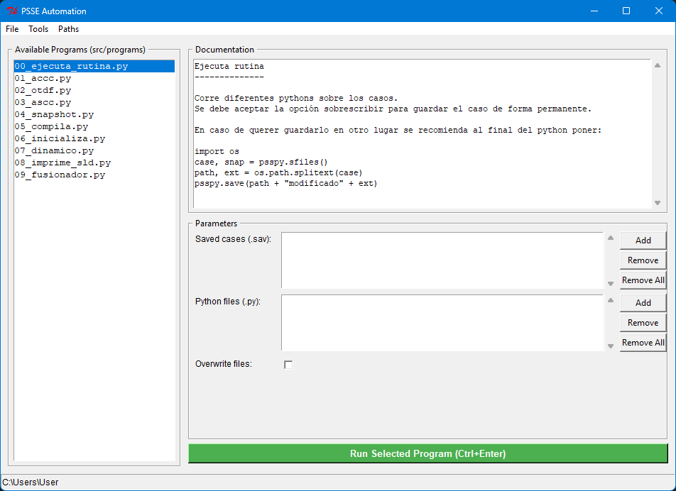

# pssetools

[](https://www.python.org/)
[](https://opensource.org/licenses/MIT)
[](https://github.com/jbarberia/pssetools/issues)

**pssetools** es una colección de módulos, scripts y utilidades en Python para automatizar, analizar y extender las capacidades de Siemens PSS®E. Este proyecto busca simplificar tareas repetitivas como la ejecución de flujos de carga, simulaciones dinámicas y la extracción/procesamiento de resultados.

## 🚀 Características principales

* **Automatización:** Scripts listos para ejecutar simulaciones masivas.
* **Extracción de datos:** Convierte los resultados de PSS®E (.sav, .out) a formatos manejables (Pandas DataFrames, CSV, Excel).
* **Gestión de la API:** Funciones envolventes (*wrappers*) que facilitan la inicialización de `psspy` y la configuración del entorno.

## 📋 Requisitos previos

Para utilizar esta librería, es **estrictamente necesario** contar con:

1. Una instalación válida y con licencia de **Siemens PSS®E** (v34 o v36 recomendadas).
2. **Python** compatible con tu versión de PSS®E (por ejemplo, Python 2.7 para versiones antiguas, o Python 3.14 para PSS®E 36).
3. Dependencias de Python (listadas en `requirements.txt`).

## 🛠️ Instalación

```bash
C:\python27\python.exe -m pip install pandas openpyxl
C:\python27\python.exe -m pip install git+https://github.com/jbarberia/pssetools

C:\python314\python.exe -m pip install pandas openpyxl PyMuPDF
C:\python314\python.exe -m pip install git+https://github.com/jbarberia/pssetools
```

## 📋 Requisitos

* **Siemens PSS®E** con licencia válida (v33, v34 o v35).
* **Python**: Debe coincidir con el intérprete de tu versión de PSS®E (Python 2.7 o Python 3.x).
* **Librerías externas:** (Instalar vía `pip`)
  * `pandas` (para exportación de resultados a Excel).
  * `openpyxl` (motor de Excel para pandas).
  * `PyMuPDF` (para corrección y recorte de SLDs a PDF).


## ¿Como se usa?

En la termina interactiva del PSSE poner:

```
import pssetools
pssetools.gui()
```



## Analisis de sensibilidad

La herramienta se abre desde `Tools > Sensitivity Analysis...` dentro de la
interfaz principal. Debe ejecutarse en el interprete de Python asociado a la
instalacion activa de PSS/E, con un caso cargado cuando se seleccionan ramas,
barras o interfaces.

### Archivo DFX

El boton `DFAX...` permite generar o regenerar el archivo de factores de
distribucion. El dialogo recibe:

* archivo de subsistemas (`.sub`);
* archivo de elementos monitoreados (`.mon`);
* archivo de contingencias (`.con`);
* archivo de salida (`.dfx`).

Al seleccionar un DFX existente, la herramienta intenta recuperar desde su
metadata los archivos `.sub`, `.mon` y `.con` asociados. Las casillas de
ordenamiento y monitoreo de lineas fuera de servicio aparecen activadas por
defecto.

### Calculo y resultados

`Solve` utiliza las APIs nativas de PSS/E según el dispositivo elegido:

* `sensitivity_flow` para una rama o transformador;
* `sensitivity_flows` para ramas de un subsistema;
* `sensitivity_voltage` para una barra;
* `sensitivity_voltages` para barras de un subsistema;
* `sensitivity_interface` para una interfaz.

El reporte textual se escribe en el directorio temporal configurado en
`Paths > Configure Paths...` como `sensitivity_report.txt`. Luego se procesa
como tabla Excel en `sensitivity_report.xlsx`.

Las primeras columnas identifican el elemento estudiado:

| Columna | Descripcion |
| --- | --- |
| `FROM_BUS` | Numero de la barra de origen |
| `FROM_BUS_NAME` | Nombre de la barra de origen |
| `FROM_BUS_KV` | Nivel de tension de la barra de origen |
| `TO_ELEMENT` | Rama, transformador o interfaz estudiada |
| `BUS`, `BUS_NAME` | Barra que aporta el factor de sensibilidad |
| `SENSITIVITY` | Factor calculado por PSS/E |

Para exportar a Excel se requiere `pandas` y `openpyxl`. El parser tambien
reconoce reportes con secciones `GENERATOR BUS`, `LOAD BUS` y `BUS NAME`.

## Estructura del proyecto

* `pssetools/main.py`: ventana principal y descubrimiento dinamico de programas.
* `pssetools/programs/`: programas ejecutables que heredan de `BaseProgram`.
* `pssetools/tools/`: asistentes graficos para tareas interactivas de PSS/E.
* `pssetools/utils/`: funciones de procesamiento, exportacion y parsing.
